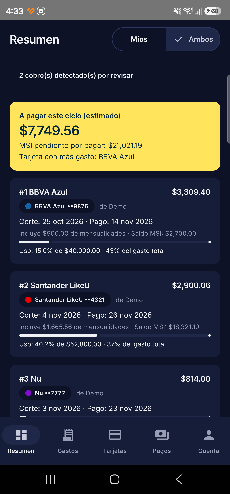
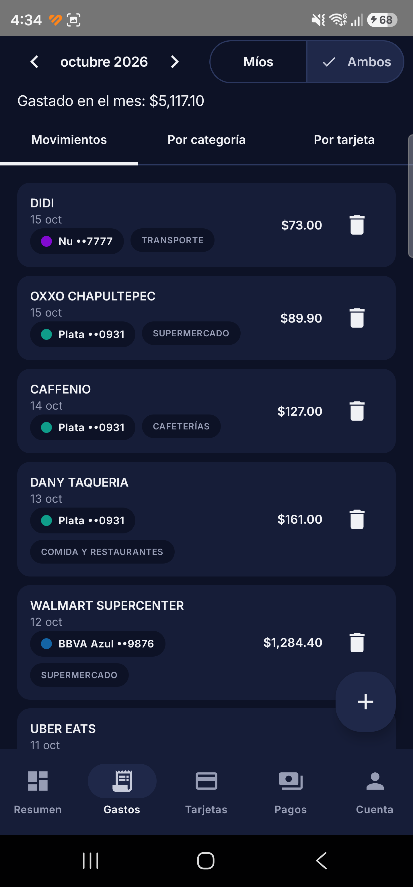
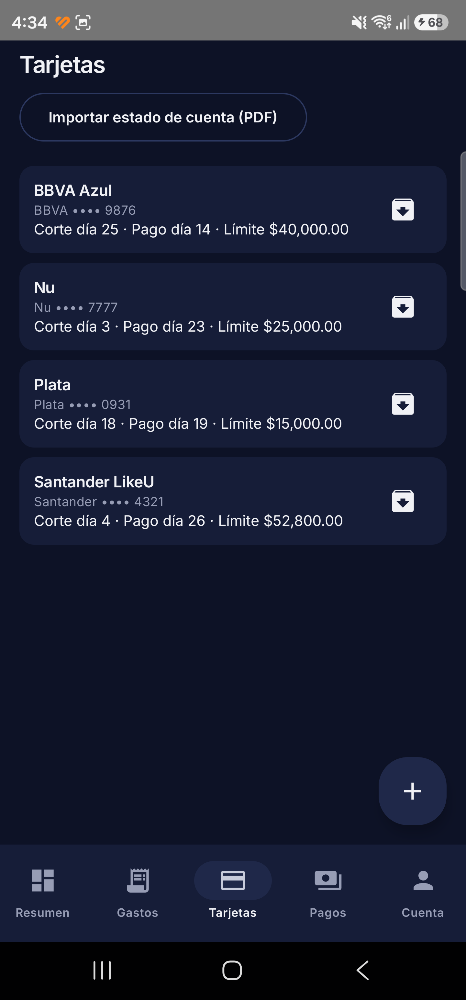
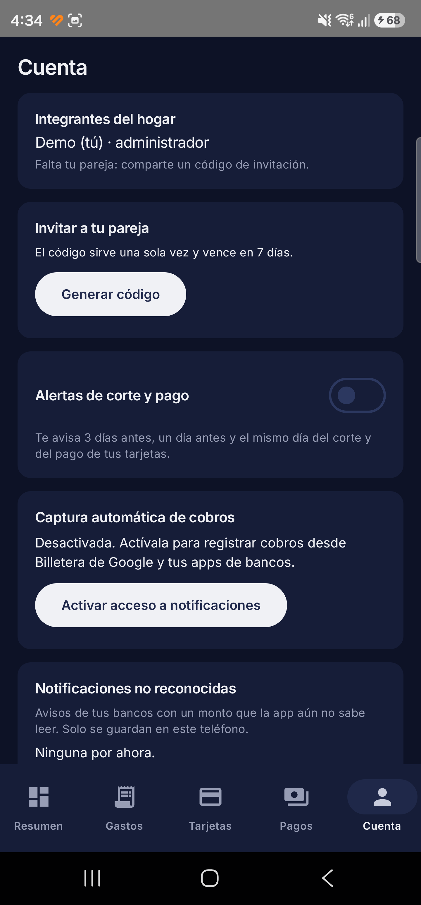
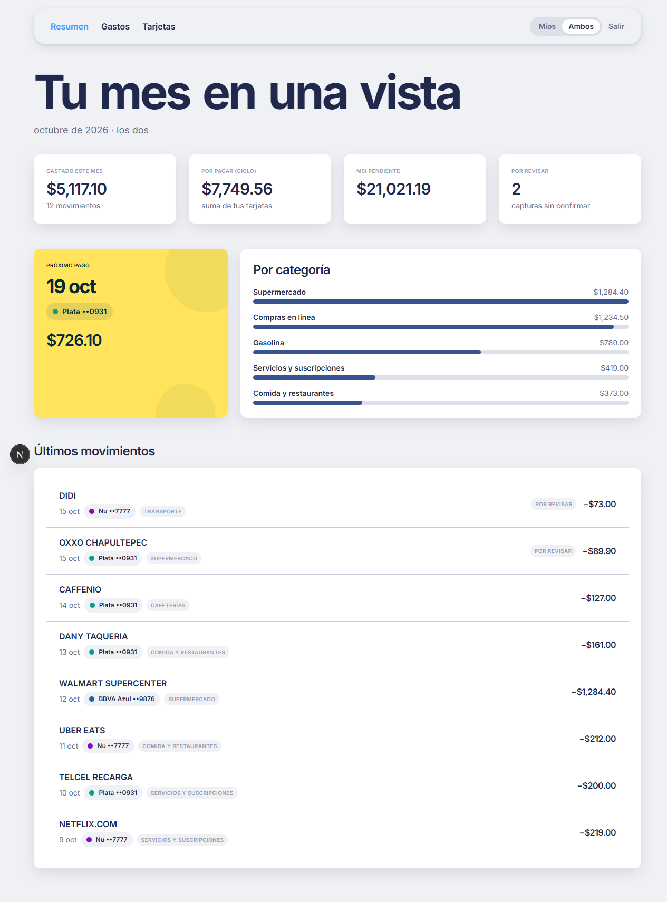
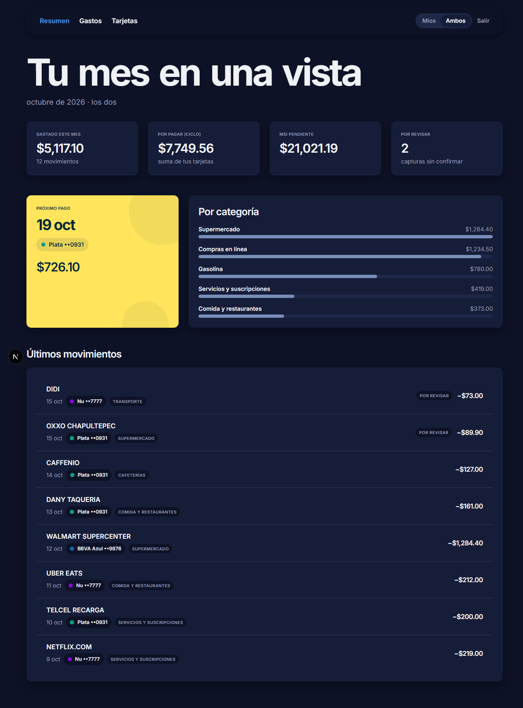
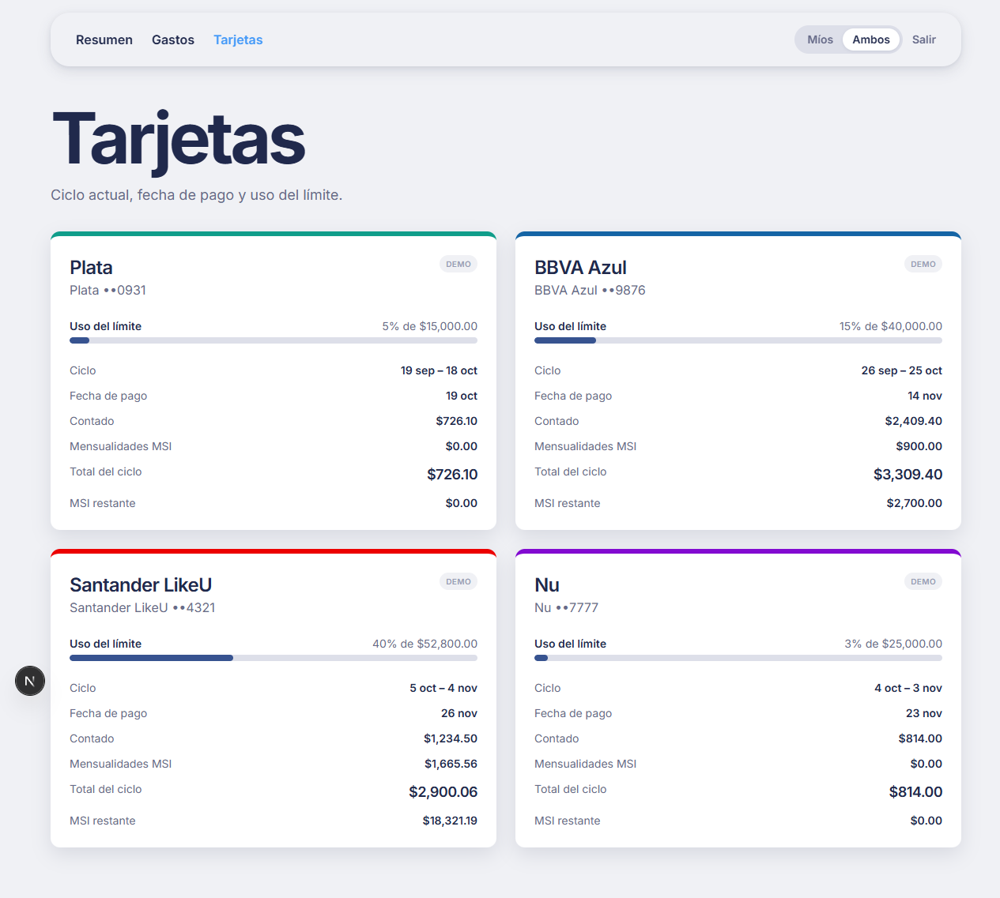
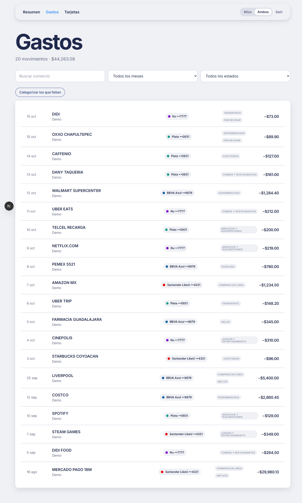

<p align="center"></p>

# HouseFinanceAdmin

Finanzas de tarjetas de crédito para **dos personas** (MXN): qué se gastó, en qué tarjeta, cuándo es el
corte y cuánto hay que pagar. App Android + dashboard web + backend en Supabase.

**Web en producción:** https://house-finance-admin.vercel.app (Vercel, se redespliega con cada push a `main`).

**Descargar la app (Android):** https://house-finance-admin.vercel.app/descargar

> Las capturas usan **datos de demostración inventados**, no cuentas reales.

## Capturas

### App Android (modo oscuro; sigue el tema del teléfono)

| Resumen | Gastos | Tarjetas | Cuenta y alertas |
|---|---|---|---|
|  |  |  |  |

### Dashboard web



| Modo oscuro | Tarjetas |
|---|---|
|  |  |



## Qué hace

- **Cuentas de pareja** con código de invitación. Cada quien edita solo lo suyo; la vista "Ambos" es de lectura.
- **Tarjetas** con ciclo de corte/pago, límite, % de uso, color por banco y etiqueta "Banco ••1234".
  Se editan desde la app (nombre, banco, corte, pago, límite, **presupuesto mensual** y **color**).
- **Presupuesto mensual por tarjeta**: avisa a los dos cuando el gasto del mes lo supera.
- **Gastos** de contado o a meses (MSI) con la mensualidad en la que van, notas y categoría.
- **Categorías automáticas**: aprende de tu historial y, si no, usa palabras clave (Telcel → servicios,
  Caffenio → cafeterías, una taquería → comida…). 16 categorías por defecto.
- **Captura automática**: lee notificaciones de Billetera de Google y de apps de bancos; los cobros llegan a
  una bandeja para revisar. El mismo cobro por dos fuentes se deduplica en el servidor.
- **Estados de cuenta en PDF**: lectura en el teléfono y conciliación contra lo registrado. Los PDFs
  **escaneados** se leen con OCR local (ML Kit). Probado con Plata, Rappi, BBVA, Nu y Santander.
- **Pagos en efectivo o transferencia** con evidencia (foto/PDF) en un bucket privado.
- **Alertas de corte y pago**: avisos 3 días antes, 1 día antes y el mismo día (WorkManager). Tampoco
  avisan de lo que ya se pagó. Aparte: aviso al acercarse o pasarse del presupuesto, un aviso por cada cobro
  detectado ("Gastaste $X en Y", con su propio canal y interruptor) y recordatorio cada 15 días de un préstamo abierto.
- **Pagos a tarjeta**: cada corte cerrado queda `pagado`, `solo mínimo`, `parcial`, `pendiente` o `vencido`
  (o "sin registro" si la tarjeta nunca ha registrado un pago). Los pagos del estado de cuenta se detectan solos.
- **Resumen por quincena**: dos bloques con lo que se paga del 1 al 15 y del 16 a fin de mes. Pasado el 15, el
  primero pasa a "Próximo mes a pagar 1ª quincena". Cada tarjeta muestra lo que toca pagar, su fecha ("vence
  en 9 días") y "Debes en total"; se ordenan por vencimiento.
- **Conciliar con el banco**: capturas el "saldo utilizado" que muestra tu banco y la app te dice si cuadra o
  cuánto falta. Los estados de cuenta también cancelan una compra con su devolución y reconstruyen las compras
  a meses de bancos que solo listan cada mensualidad (Banamex).
- **Préstamos entre personas**, aparte de los gastos: abonos, saldo por persona y perdón de la deuda.
- **Presupuestos por categoría** individuales (cada quien el suyo; el gasto del hogar es visible para los dos),
  **gastos recurrentes** detectados y **reportes** de mes contra mes por categoría y por tarjeta.
- **Bloqueo con huella o PIN** del teléfono (opcional).
- **Dashboard web** de solo lectura con edición de monto y categoría, mismo login que la app.
- **Actualizaciones dentro de la app**: al abrirla avisa si hay versión nueva (`latest.json` en el bucket
  público), la descarga, verifica su SHA-256 y abre el instalador de Android. También en Cuenta →
  "Buscar actualizaciones".

## Arquitectura

```
android/   Kotlin + Jetpack Compose + supabase-kt (tema Fold claro/oscuro, fuente Inter)
web/       Next.js (App Router) + Tailwind v4 + supabase-js
supabase/  Postgres + RLS + funciones SQL + pruebas pgTAP (migraciones versionadas)
docs/      Capturas del README
```

- **Seguridad**: RLS por hogar en todas las tablas; el bucket de evidencias es privado.
- **Privacidad**: los PDFs se leen y se reconocen **en el dispositivo**; solo se sube el archivo como
  evidencia si confirmas la importación. Las notificaciones no reconocidas se guardan solo en el teléfono.
- **Lógica en el servidor** (una sola fuente de verdad para app y web): ciclos de tarjeta, deduplicación de
  capturas, importación idempotente de estados de cuenta y sugerencia de categoría.

## Reglas de negocio

- El día de corte pertenece al ciclo que cierra; lo del día siguiente entra al corte siguiente.
- MSI: se registra el número de mensualidades y **en cuál va**; cada ciclo posterior carga una mensualidad.
- % de uso = (total del ciclo + saldo MSI pendiente) / límite de crédito.
- "Debes en total" = corte anterior sin pagar + total del ciclo + mensualidades que faltan. El saldo MSI incluye
  las compras con mensualidad 0 (la primera cae en el corte siguiente).
- El banco manda: importar un estado de cuenta ajusta corte, pago y límite de la tarjeta. La **fecha límite de
  pago** sale del estado de cuenta; si el ciclo aún no tiene estado, se copia el desfase en meses del último
  (hay bancos que cobran el mes siguiente al corte).
- Un estado de cuenta ya viene neto de los pagos hechos antes de su corte: por eso no se arrastra el sobrante
  del ciclo anterior cuando el monto sale de un estado importado.
- Un gasto a meses se cuenta por su mensualidad en el ciclo, no por su monto total. Los préstamos entre
  personas van aparte y no afectan los reportes de gasto.

## Desarrollo local

Requisitos: Docker Desktop, Node 20+, JDK 17, Android SDK 34.

```bash
# Backend local
npx supabase start
npx supabase test db supabase/tests/database/08_default_categories.test.sql   # pgTAP

# Web
cd web && cp .env.example .env.local   # URL y llave publishable de `npx supabase status`
npm install && npm run dev

# Android: crear android/local.properties (no versionado)
#   sdk.dir=...
#   supabase.url=http://127.0.0.1:54321    # con teléfono por USB: adb reverse tcp:54321 tcp:54321
#   supabase.key=<publishable key>
cd android && ./gradlew testDebugUnitTest installDebug
```

Una copia de demostración (otro paquete, no toca tu sesión):
`./gradlew assembleDebug -Pdemo -Psupabase.url=... -Psupabase.key=...`

### Publicar una versión nueva de la app

```bash
cd android && ./gradlew assembleRelease     # sube versionCode/versionName en app/build.gradle.kts antes
cd .. && ./scripts/publish-android.ps1 -Notes "Qué cambió"
```

El script sube el APK firmado y `latest.json` al bucket `releases`, verifica el hash descargado y la
página `/descargar` toma la versión sola. La llave de firma NO está en el repo (`android/keystore.properties`).

### Producción en Supabase Cloud

```bash
npx supabase login            # en una terminal real (abre el navegador)
npx supabase link --project-ref <ref>
npx supabase db push          # aplica las migraciones
```

Apunta la app y la web a la URL del proyecto y su llave **publishable**. Desactiva "Confirm email" en
Authentication si no quieres confirmar correos.

## Pruebas

- **Android**: más de 440 pruebas unitarias (parsers de cobros y estados, OCR, alertas, ciclos, conciliación,
  quincenas, préstamos, reportes).
- **Base de datos**: pgTAP por archivo en `supabase/tests/database/`.
  Los archivos usan correos de prueba fijos: si tu base local ya tiene ese usuario, corre uno por uno.

## Estado

Hecho: todo lo anterior, incluido el APK de release firmado y publicado, y la web desplegada.
Pendiente: respaldos automáticos de la base, exportar a CSV, captura por Gmail y sugerir abonos de préstamos
desde transferencias recibidas.
